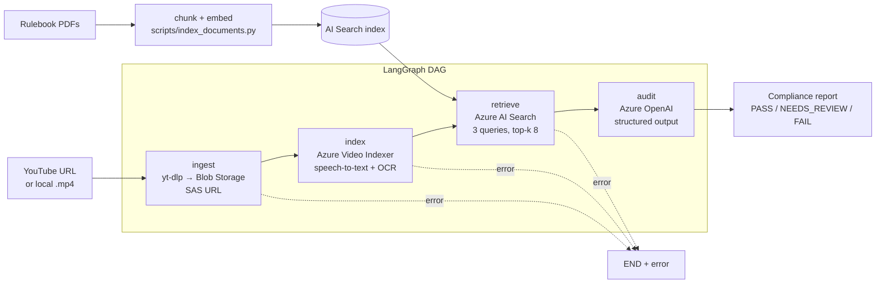

# Brand Guardian AI — Video Ad Compliance Auditor

An agentic pipeline that audits video ads against advertising regulations (FTC endorsement rules, YouTube Ads policies) and produces a structured compliance report. Each finding includes a severity, the exact claim and its timestamp, the rule it breaks, and a suggested compliant rewrite.

Reviewing videos for compliance by hand is slow, expensive and easy to get wrong. A single missed issue, such as an absolute guarantee or an undisclosed sponsorship, can lead to brand damage, legal penalties or a platform takedown. Brand Guardian ingests a video, extracts what is **said** (speech-to-text) and **shown** (on-screen text via OCR), retrieves the relevant regulatory rules, and reasons over every claim.

## Results

The first end-to-end audit, a 30-second YouTube skincare ad:

| | |
|---|---|
| Verdict | **FAIL**: 1 HIGH and 1 MEDIUM violation |
| Key finding | Flagged *"…dedicated to delivering **proven results**"* at `00:14` as an unsubstantiated efficacy claim and cited the FTC guide page |
| Runtime | ~5.5 minutes end to end, almost all of it in Video Indexer processing |
| Cost | Under $0.20 per 30-second video |
| Knowledge base | 2 rulebooks, 31 pages, 37 vector chunks |

## Architecture

The pipeline is a LangGraph DAG over a shared typed state. Any node that fails sends the graph straight to `END`, and the error is returned instead of passing bad data downstream.



| Stage | Node | Service | Output |
|---|---|---|---|
| Ingestion | `ingest_node` | yt-dlp + Blob Storage | Read-only SAS URL for the video |
| Indexing & extraction | `index_node` | Azure AI Video Indexer | Timestamped transcript and OCR text |
| Retrieval | `retrieve_node` | Azure AI Search + OpenAI embeddings | Deduplicated rulebook chunks with source and page |
| Reasoning | `audit_node` | Azure OpenAI (Pydantic structured output) | Violations: category, severity, claim, timestamp, rule, fix |

**Design choices**
- **The verdict is computed by fixed rules, not by the LLM:** `FAIL` if there is any CRITICAL or HIGH violation, `NEEDS_REVIEW` if there are only MEDIUM or LOW ones, and `PASS` if there are none.
- **Retrieval uses several queries:** one on the video's own content, plus targeted queries for disclosure and misleading-claim rules, so key rule families are always considered.
- **Cost guardrail:** YouTube videos longer than `MAX_VIDEO_MINUTES` (default 5) are refused *before* download, because Video Indexer bills per minute.
- **Timestamps everywhere:** transcript and OCR lines carry `[mm:ss]` markers, so every finding points to the exact moment in the video.

## Project layout

```
brand_guardian/
  config.py              # env-driven settings
  state.py               # graph state + Pydantic report schema + verdict logic
  nodes.py               # the 4 pipeline nodes + audit prompt
  graph.py               # LangGraph wiring, run_audit()
  api.py                 # FastAPI: /audit, background /jobs, web UI
  static/index.html      # web UI with live progress for each step
  services/
    storage.py           # yt-dlp download (H.264, cost guard) + Blob upload/SAS
    video_indexer.py     # Video Indexer auth (ARM), upload, polling, insight extraction
    knowledge_base.py    # Azure AI Search vector store
scripts/index_documents.py  # rulebook PDFs → Azure AI Search
data/rulebooks/             # put compliance PDFs here (not committed)
main.py                     # CLI
tests/                      # unit tests, no Azure credentials needed
```

## Setup

**Prerequisites:** Python 3.11+, the [Azure CLI](https://learn.microsoft.com/cli/azure/install-azure-cli), and these Azure resources:
- **Azure OpenAI** with a chat deployment (e.g. `gpt-4.1-mini` or `gpt-4o`) and an embedding deployment (`text-embedding-3-small`)
- **Azure AI Search** (the Free tier is enough)
- **Storage account**
- **Azure AI Video Indexer** (ARM-based account) linked to that storage account

```bash
python -m venv .venv && source .venv/bin/activate
pip install -r requirements.txt
cp .env.example .env        # fill in endpoints and keys
az login --tenant <tenant-id>
```

**Setup gotchas (each of these broke a real run):**
- `AZURE_OPENAI_ENDPOINT` must be the resource's base URL (`https://<name>.openai.azure.com/`), not a full `/openai/v1/responses` URL.
- `AZURE_OPENAI_API_VERSION` is an API version such as `2024-10-21`. Don't confuse it with the model version (e.g. `2025-04-14`), which returns 404.
- Video Indexer's **managed identity needs the `Storage Blob Data Owner` role** on its linked storage account. Without it, every video fails with `StorageAccessDenied`. New role assignments take about 5–10 minutes to take effect.
- If YouTube answers "confirm you're not a bot", sign in to YouTube in a browser and set `YTDLP_COOKIES_BROWSER=firefox` (or `chrome`).
- Downloads are forced to **H.264**, because Video Indexer rejects YouTube's AV1 streams with `InvalidFileFormat`.

### 1. Build the knowledge base

Put rulebook PDFs in `data/rulebooks/`. They aren't committed to this repo; download them yourself. Examples:
- FTC, [*Disclosures 101 for Social Media Influencers*](https://www.ftc.gov/business-guidance/resources/disclosures-101-social-media-influencers)
- FTC, *Guides Concerning the Use of Endorsements and Testimonials in Advertising*
- Google, YouTube Ads policies and ad specs

Then run:

```bash
python scripts/index_documents.py
```

### 2. Audit a video

**Web UI**
```bash
uvicorn brand_guardian.api:app --port 8010
```
Open http://localhost:8010, paste a YouTube URL and watch each step (Ingest → Index → Retrieve → Audit) complete. The report appears on the page with a JSON download link.

**CLI**
```bash
python main.py "https://www.youtube.com/watch?v=<id>" -o reports/report.json -v
python main.py ./my_ad.mp4          # local files work too
```
Exit codes are `0` for PASS or NEEDS_REVIEW, `2` for FAIL and `1` for a pipeline error, so the CLI can gate a CI step.

**API**

| Endpoint | Purpose |
|---|---|
| `POST /jobs` `{"video_url": …}` | Starts an audit in the background and returns `{"id": …}` |
| `GET /jobs/{id}` | Status, completed steps, errors and the report |
| `POST /audit` | Synchronous audit that returns the report directly |
| `GET /docs` | Interactive OpenAPI docs |

### Sample report (real output, trimmed)

```json
{
  "status": "FAIL",
  "summary": "The video promotes skincare products ... some claims about product efficacy are presented without substantiation, which may be misleading.",
  "violations": [
    {
      "category": "Unsubstantiated Claim",
      "severity": "MEDIUM",
      "claim": "All of the Aino products provide highly effective natural ingredients dedicated to delivering proven results.",
      "timestamp": "00:14",
      "source": "transcript",
      "rule_reference": "1001a-influencer-guide-508_1.pdf, page 6",
      "explanation": "The claim that the products deliver 'proven results' is an absolute claim that requires substantiation.",
      "recommendation": "Provide reliable evidence or rephrase, e.g. 'formulated with natural ingredients to support skin health.'"
    }
  ]
}
```

## Cost

| Service | Cost |
|---|---|
| Video Indexer | The main cost, billed per minute of video indexed |
| Azure OpenAI | About $0.01 per audit with `gpt-4.1-mini` |
| AI Search | $0 on the Free tier |
| Storage | Cents per month |

There is no always-on compute, so the project costs nothing while idle apart from storage.

## Tests

```bash
pytest -q
```
The 6 unit tests cover transcript and OCR extraction (timestamps, deduplication), verdict logic, rule formatting, graph routing including the stop on first error, and the web UI's job flow. Azure is mocked, so no credentials are needed. CI runs them on every push via GitHub Actions.

## Known limitations

- Disclosure rules can be over-applied to a brand's **own** ads. FTC sponsorship disclosure targets influencers and endorsers, but the auditor may flag it on first-party commercials.
- Video Indexer takes about as long as the video itself or longer, so audits are slow for long videos.
- The job store is in memory. A production deployment would use a queue and a database.
- Only download YouTube content you own or are permitted to process.
